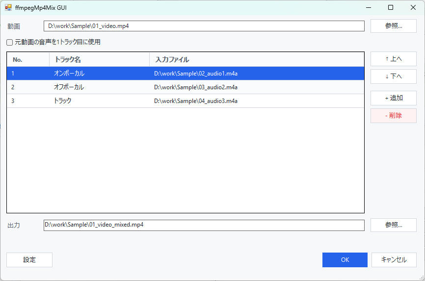
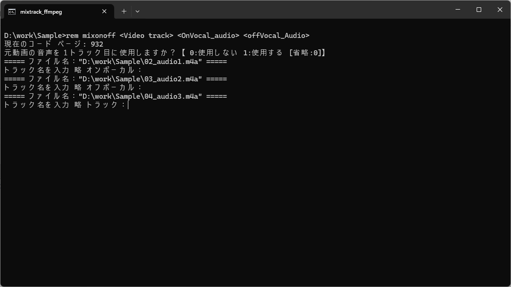

# PitaTrack (ぴたトラック)

PitaTrack is a Windows tool for combining one video file and multiple audio files into a single MP4 while assigning names to each audio track. It was formerly called ffmpegMp4Mix.

It uses `ffmpeg` to create MP4 files whose audio track names are easier to identify in players such as MPC-BE.

## Features

- Install from the [Microsoft Store](https://apps.microsoft.com/detail/9NSM4JBT6Z9T) and start using it (ffmpeg is included; works on PCs where Smart App Control is on)
- A ZIP version is also available: extract it and open `setup` (ffmpeg is downloaded for you)
- Launch from the right-click menu (Store version: "ぴたトラックでまとめる"; ZIP version: **Send To**) or by dragging files
- Uses the first `.mp4` file found as the video, even when it is not first in the received order
- Configure default track names
- Optionally use the source video's audio as the first track
- Shift each audio track earlier or later (in milliseconds)
- Configure the output file suffix
- CLI batch workflow is also available

GUI only:

- GUI workflow for selecting a video and audio tracks
- View and edit track names, and choose from candidates
- Add, delete, and reorder tracks
- Swap the main video with an `.mp4` file in the audio tracks
- Auto-adjust each track's offset by comparing it with the video's audio
- Create off-vocal, vocal-reduced, and karaoke (backing vocals kept) tracks from one audio track (vocal separation; the models are downloaded on first use)

Features under `GUI only` are available only in the GUI. The CLI uses file order and interactive prompts instead.

## Which file should I use?

| Purpose | Store version right-click item | ZIP version Send To name | ZIP version file |
|---|---|---|---|
| Check and adjust tracks in a window (GUI) | ぴたトラックでまとめる | ぴたトラック | `mixtrack_ffmpeg_gui` |
| Finish quickly with fewer steps (CLI) | ぴたトラック (CLI版) でまとめる | ぴたトラック (CLI版) | `mixtrack_ffmpeg` |

With the Store version, select video or audio files and right-click them to see "ぴたトラックでまとめる" (GUI) and "ぴたトラック (CLI版) でまとめる" (CLI).

After installing the ZIP version, **Send To** has the entries "ぴたトラック" (GUI) and "ぴたトラック (CLI版)" (CLI). When using the ZIP version without installing it, or when dragging files directly, use `mixtrack_ffmpeg_gui` or `mixtrack_ffmpeg` in the root folder.
If file extensions are hidden in Explorer, `.bat` is not shown.

## Screenshots

### GUI



### CLI



## Folder Layout

This is the layout of the ZIP version (the Store version is installed in a location managed by Windows).

The root folder contains the drag-and-drop entry files. Internal files are kept in `tools`.
When installed, this folder is `%LOCALAPPDATA%\Programs\PitaTrack`.

```text
PitaTrack\
  setup.bat                  Setup (install and update)
  PitaTrack.exe              Launcher (created by setup or tools\makesendto)
  mixtrack_ffmpeg.bat        CLI entry file
  mixtrack_ffmpeg_gui.bat    GUI entry file
  README_ja.md
  README.md
  tools\
    ffmpeg.exe               Downloaded by setup or on first launch
    ffmpeg-licenses\         ffmpeg license and source location (downloaded with ffmpeg.exe)
    bsroformer\              Vocal separation engine (BSRoformer.cpp; downloaded on first use)
    mixtrack_ffmpeg_gui.ps1
    mixtrack_ffmpeg_gui.settings.json
    pitatrack.ico            Icon
    setup.ps1
    makesendto.bat
    removesendto.bat
```

`PitaTrack.exe` is a small launcher that opens the GUI without a console window. It is not in the release ZIP: setup (or `tools\makesendto`) builds it on your PC with the C# compiler that comes with Windows. The shortcuts, Send To entries, and uninstaller use it. VBScript is not used.

`ffplay.exe` and `ffprobe.exe` are not required, but it is fine to keep them with `ffmpeg.exe`.

## Requirements

- Store version: Windows 10 version 2004 or later, or Windows 11 (x64). ffmpeg is included.
- ZIP version: Windows 10 or Windows 11, PowerShell 5.x, and `ffmpeg.exe` (downloaded automatically by setup)
- Both use the PowerShell built into Windows, so they do not run on Windows in S mode.
- For vocal separation, a GPU with Vulkan (NVIDIA / AMD / Intel) makes it much faster. It also works without one, but takes minutes to tens of minutes per model.

## Installation

### From the Microsoft Store (Recommended)

1. Open [PitaTrack in the Microsoft Store](https://apps.microsoft.com/detail/9NSM4JBT6Z9T).
2. Press **Get** (or **Install**).

That's all.

- `ffmpeg`, which is needed to create MP4 files, is included. Nothing else needs to be downloaded.
- The vocal separation engine is included too. Its models are downloaded on first use.
- It works on PCs where Windows 11 **Smart App Control** is on.
- New versions arrive automatically from the Microsoft Store.
- Select video or audio files and right-click them to see "ぴたトラックでまとめる" (GUI) and "ぴたトラック (CLI版) でまとめる" (CLI). You can also open "ぴたトラック" from the Start menu.
- If you installed the ZIP version with `setup`, the Store version reads its settings (once you save settings in the Store version, those are used from then on). The ZIP version stays installed; uninstall it if you no longer need it.
- Uninstall it like other Store apps from **Settings → Apps → Installed apps**. Its settings are removed too.

### Install from the ZIP

Use the ZIP version on PCs that cannot use the Microsoft Store, or to use PitaTrack without installing it.

1. Download `PitaTrack_vX.Y.Z.zip` from [GitHub Releases](https://github.com/bee7813993/ffmpegMp4Mix/releases).
2. Right-click the downloaded ZIP and choose **Extract All**.
3. Double-click `setup` in the extracted folder.
4. Press **インストール** (install).
5. When "インストールが完了しました。" (installation complete) is shown, press **閉じる** (close).

That's all.

- `ffmpeg`, which is needed to create MP4 files, is downloaded automatically (about 2 MB). You do not need to get it yourself.
- The vocal separation engine (about 22 MB) and its models are downloaded on first use.
- No administrator rights are needed. The tool is installed to `%LOCALAPPDATA%\Programs\PitaTrack`.
- "ぴたトラック" is added to **Send To**, the desktop, and the Start menu. You can choose which ones in the setup window.
- After installation, you can delete the extracted folder and the ZIP file.
- If you used ffmpegMp4Mix from **Send To**, its settings and `ffmpeg.exe` are carried over. The setup window also lets you remove the old Send To entries (mixtrack_ffmpeg).

If Windows shows "The publisher could not be verified. Are you sure you want to run this software?" when you open `setup`, press **Run**. If it shows "Windows protected your PC", press **More info** → **Run anyway**. Windows asks this for files downloaded from the internet.

When you open `setup`, a console window flashes briefly before the setup window appears.

On PCs where Windows 11 **Smart App Control** is on, the ZIP version is blocked and does not run. Use the [Microsoft Store version](https://apps.microsoft.com/detail/9NSM4JBT6Z9T) instead. For details, see [Nothing Happens When Opening setup (Smart App Control)](#nothing-happens-when-opening-setup-smart-app-control).

#### Updating

Follow the same steps with the ZIP of the new version. The window says it will update, and your settings and `ffmpeg.exe` are kept.

`mixtrack_ffmpeg.bat` is replaced with the new one. If you edited the CLI settings in it (such as `USE_VIDEO_AUDIO`), set them again.

#### Uninstalling

In Windows **Settings → Apps → Installed apps** (Windows 10: **Settings → Apps → Apps & features**), select "ぴたトラック" and choose **Uninstall**.

The shortcuts, Send To entries, settings, and `ffmpeg.exe` are also removed. The vocal separation models (`%LOCALAPPDATA%\PitaTrack\models`) are kept; delete them if you no longer need them.

### Using Without Installing

You can also use the tool from the extracted folder.

1. Extract the ZIP file to any folder.
2. To use Windows **Send To**, run `tools\makesendto`.
3. If `ffmpeg.exe` is not found on first launch, a download window is shown. Press **ダウンロード** (download) to place it in the `tools` folder.

To provide `ffmpeg.exe` yourself, download it from [ffmpeg.org](https://ffmpeg.org/download.html) and copy it into the `tools` folder.

After running `tools\makesendto`, select files in Explorer and choose **Right click → Send To → ぴたトラック** or **ぴたトラック (CLI版)**. It also builds the `PitaTrack.exe` launcher in that folder.

When you double-click `mixtrack_ffmpeg_gui` or drop files onto it, a console window flashes briefly before the GUI opens. If a file name containing symbols such as `&` is not passed correctly, open the GUI from the **Send To** entry registered by `tools\makesendto` instead.

To remove the Send To shortcuts, run `tools\removesendto`. It also removes the old Send To entries (mixtrack_ffmpeg_gui and mixtrack_ffmpeg).

## GUI Usage

The GUI lets you check track names and order before running `ffmpeg`.

### Prepare Files

Place the video file and audio files you want to combine in the same folder.

File order matters. Adding numbers to the beginning of file names makes them easier to sort in Explorer and easier to pass in the intended order.

Example:

```text
01_video.mp4
02_audio1.m4a
03_audio2.m4a
```

### Launch from the Right-Click Menu

1. Select the video and audio files.
2. Right-click them and choose:
   - Store version: **ぴたトラックでまとめる**
   - ZIP version: **Send To → ぴたトラック**. In Windows 11, **Send To** is under **Right click → Show more options**.
3. The track list is shown.
4. Edit track names, order, and output path as needed.
5. Press **保存** (save) to run `ffmpeg` and create the output file.
6. Press **閉じる** (close) when you are done.

**保存** does not close the window, so you can adjust offsets or other settings and save again as many times as you like.

- When saving finishes, "保存しました" (saved) is shown at the bottom of the window.
- Re-saving to a file already saved from the same window skips the overwrite confirmation.
- Saving may fail while the output file is open in a player. Close it in the player and save again.

When launched from the right-click menu, the received file order is used as the initial track order. In the GUI, you can reorder tracks before running.

With the ZIP version, you can also drag and drop the video and audio files together onto "ぴたトラック" on the desktop.

### Launch by itself

Open "ぴたトラック" from the desktop or the Start menu to open the GUI without input files. When using the tool without installing it, double-click `mixtrack_ffmpeg_gui`.

- Use **Browse...** in the video field to select the video file.
- Use **+ Add** to add audio files.
- Drag and drop audio or video files onto the track list.
- Drag and drop a video file onto the video field to replace it.

If the video field is empty and multiple files are dropped onto the track list, the first `.mp4` file is assigned to the video field and the remaining files are added as audio tracks.

### Edit Track Names

- Type directly into a track name cell.
- Click a track name cell to open registered track name candidates.
- With the keyboard, press `Alt + Up`, `Alt + Down`, or `F4` on a track name cell to open candidates.
- Names not in the candidate list can still be typed directly.

### Shift Audio Timing

- Enter the shift in milliseconds in the **Offset (ms)** column (`オフセット(ms)` in the GUI).
- `+500` delays the track by 0.5 seconds, and `-500` makes it start 0.5 seconds earlier. `0` or an empty cell means no shift.
- You can also use the buttons above the track list or the keyboard.

  | Action | Button | Keyboard |
  |---|---|---|
  | Change the selected track | `-100ms` / `+100ms` next to **選択トラック** (selected track) | `Ctrl + Down` / `Ctrl + Up` |
  | Change every track | `-100ms` / `+100ms` next to **全トラック** (all tracks) | `Ctrl + Shift + Down` / `Ctrl + Shift + Up` |
  | Shift every track by a given amount | Enter a value in the **全トラック** box and press **ずらす** (shift), or press `Enter` in the box | - |

  - Change the step with **オフセット増減幅(ms)** (offset step) in Settings. The default is 100 ms.
  - The keyboard shortcuts work wherever the focus is in the window. The selected track is the row highlighted in blue in the track list.
  - **ずらす** adds the entered value to each track's current offset, so the differences between tracks are kept.
- Starting earlier trims the beginning of the audio (no re-encoding).
- Delaying follows the **delay method** setting. See [Delay Method](#delay-method) for details.
- If you enter something other than an integer, the previous value is restored.

### Auto-Adjust Offsets

Press **自動調整** (auto-adjust) to compare each track with the video's audio, find the lag, and fill in the offset. The source video's audio track is skipped.

- It is designed to work with on-vocal and off-vocal versions of the same song, other singers, different keys, live recordings, and different arrangements.
- Tracks that share the same backing track are matched to within 1 ms; different arrangements and similar cases to within about 10 ms.
- Each result has a confidence level:

  | Confidence | What happens |
  |---|---|
  | 高 (high) | The offset is applied. |
  | 中 (medium) | The offset is applied and the cell turns yellow. Please check it. |
  | 低 (low) | Nothing is changed and the cell turns red. |

- Hover over the cell to see the detected lag and confidence.
- Turn on **自動調整を常に行う** (always auto-adjust) in Settings to run it automatically, without pressing the button:
  - When the window opens (all tracks)
  - When tracks are added (only the added tracks)
  - When the video is changed (all tracks)
- If any low-confidence (red) track is left when you press **保存** (save), a confirmation dialog is shown. Editing that track's offset by hand or with the **選択トラック** (selected track) ± buttons (`Ctrl + Up` / `Ctrl + Down`) removes it from the check. Shifting all tracks at once does not.
- Recordings played at a different speed (such as a live take with a different tempo) cannot be aligned with a single offset, so a note says the tempo or length may differ.
- Lags up to 180 seconds in either direction are searched, and the first 15 minutes of each file are analyzed.

### Reorder Tracks

- Drag and drop rows to reorder tracks.
- Use **↑ Up** / **↓ Down** to move tracks.
- Drag and drop an `.mp4` track row onto the video field to swap it with the main video.
- Or select an `.mp4` track and press **↔ 動画と交換** (swap with video). Use this when the video should be an `.mp4` other than the first one found.
- The **種類** (type) column in the track list shows each file's extension, such as `MP4` or `M4A`, so you can see which tracks are `.mp4`. The source video's audio is shown as `元動画`.
- The **入力ファイル** (input file) column shows only the file name. Hover over it to see the full path.

### Vocal Separation (Off-Vocal and More)

From one audio track you can create an **off-vocal** track (vocals removed), a **vocal-reduced** track, and a **karaoke** track that removes only the lead vocal and keeps the backing vocals.

1. Add the source audio as a track (**+ 追加**, drag and drop, or **元動画の音声を1トラック目に使用**).
2. Select that row and press **ボーカル分離** (vocal separation).
3. Choose the tracks and models and press **実行** (run). On first use you are asked to download the selected models (Kim about 240 MB, anvuew about 53 MB). The ZIP version also asks to download the separation engine (BSRoformer.cpp, about 22 MB) first; the Store version includes it.
4. The results are listed. Select a row and press **▶ 再生** to preview; selecting another row while playing switches at the same position. For the vocal-reduced track, the **ボーカル量** slider changes the amount while you listen. Click a track name to pick one from the candidates (the track name candidates in Settings and so on) or type a name.
5. Check the tracks you want and press **採用したトラックを追加** (add the selected tracks). They are inserted below the source track with the same offset. **保存...** saves a result elsewhere; the rest is deleted when the screen closes.

- Output files are m4a next to the source file (`<name>_offvocal_kim.m4a` and so on).
- **全モデルで候補を作る** makes one track per installed model so you can compare them; the best model depends on the song.
- A GPU (NVIDIA / AMD / Intel with Vulkan) is used when available. Without one it still works, but takes minutes to tens of minutes per model.
- Models are stored in `%LOCALAPPDATA%\PitaTrack\models` (in the Store version, Windows may redirect them, like the settings, to an app-specific location under `%LOCALAPPDATA%\Packages\`, which is then removed on uninstall). Wherever they are, **モデルフォルダーを開く** opens that folder, and you can add your own GGUF models for BSRoformer.cpp (BS-Roformer / Mel-Band Roformer). An optional `.json` with the same name (`{"label": "display name", "short": "short name", "role": "vocals" or "lead"}`) sets the display name, the short name used for `{model}` in track names, and the role.

The default models are the following two. Their license texts (`*.LICENSE.txt`) are downloaded next to them.

| Model | Use | Author | License |
|---|---|---|---|
| Kim Mel-Roformer | vocals (off-vocal, vocal reduce) | Kimberley Jensen | MIT |
| BS-Roformer Karaoke anvuew | lead vocal (karaoke) | anvuew | GPL-3.0 |

Both are the original weights converted to GGUF with [BSRoformer.cpp](https://github.com/chenmozhijin/BSRoformer.cpp) (MIT) and are downloaded from [GitHub Releases](https://github.com/bee7813993/ffmpegMp4Mix/releases/tag/separation-models-20261019). The engine itself (BSRoformer.cpp and ggml, both MIT) is the author's Windows (Vulkan) build, used as is. The ZIP version downloads it to `tools\bsroformer` on first use; the Store version includes it (its license is shown under **設定 → ライセンス**, Settings → License).

### Keyboard Workflow

The GUI is arranged so you can get to saving with `Tab`, text input, and `Enter` after launch. Press `Esc` to close the window.

## CLI Usage

The CLI is useful when you want to finish quickly with fewer operations and do not need to adjust tracks in a window.

### Prepare Files

Place the video file and audio files you want to combine in the same folder.

File order is especially important in the CLI because there is no screen for reordering tracks before execution.
Adding numbers to the beginning of file names makes them easier to sort in Explorer and easier to pass to the CLI in the intended order.

Example:

```text
01_video.mp4
02_audio1.m4a
03_audio2.m4a
```

### Launch

- Store version: select files, right-click, and choose **ぴたトラック (CLI版) でまとめる**
- ZIP version: select files and choose **Send To → ぴたトラック (CLI版)**
- ZIP version: drag and drop files onto `mixtrack_ffmpeg`

The first `.mp4` file found is used as the video.
All other files are added as audio tracks.

File order matters. Audio tracks are added in the order passed to the CLI.

### Prompts

1. Choose whether to use the source video's audio as the first track.

   ```text
   0: Do not use it
   1: Use it
   Enter only: 0
   ```

2. Enter each audio track name.

   Press `Enter` without input to use the default track name. If GUI settings have been saved, the GUI's default track names for that track count are used.

3. Enter each audio track's offset in milliseconds.

   `+500` delays the track by 0.5 seconds, and `-500` makes it start 0.5 seconds earlier. Press `Enter` without input to use the default shown (normally 0).

   If **自動調整を常に行う** (always auto-adjust) is on in the GUI settings, auto-adjust runs before the track name prompts and its result becomes the default offset. The result and confidence are shown before each prompt.

   For a low-confidence track (one that could not be matched), `Enter` alone does not continue. Enter `y` to continue with 0, or enter a number.

4. When complete, `source_video_name_mixed.mp4` is created in the same folder as the video. The output suffix follows the GUI settings (including per-track-count suffixes).

## Settings

### GUI Settings

Use the GUI **Settings** button to change:

- Default track names by track number (can differ by track count)
- Output file suffix (can differ by track count)
- Track name candidates
- Default name for later tracks
- Delay method and re-encoding bitrate
- Step used by the offset buttons
- Whether to always auto-adjust
- Default names for the tracks made by vocal separation (vocal cut / vocal reduce / karaoke / vocals only; `{model}` becomes the model name and `{db}` the reduce amount such as `-8` or `+6`)

GUI settings are saved to `tools\mixtrack_ffmpeg_gui.settings.json` (`%LOCALAPPDATA%\Programs\PitaTrack\tools\mixtrack_ffmpeg_gui.settings.json` when installed). The Store version saves them in an app-specific location under `%LOCALAPPDATA%\Packages\`, which is removed on uninstall.

On first launch, the GUI reads `TRACKNAME_1`, `TRACKNAME_2`, `TRACKNAME_3` ..., `TRACKNAME_LATER`, `OUTPUT_SUFFIX`, `DELAY_MODE`, and `REENCODE_BITRATE` from `mixtrack_ffmpeg.bat` as defaults.

### Track Names and Output Suffix by Track Count

Use **トラック数** (track count) at the top of the Settings window to choose what you are editing.

- **共通（下記以外のトラック数）** (common): default track names and output suffix used for any track count without its own settings.
- **2トラックのとき** (for 2 tracks) and so on: select a track count and check **このトラック数専用の設定にする** (use settings for this track count) to create settings for that count, starting from the common values. Track counts with their own settings are marked "（専用）".
- Unchecking it deletes those settings and goes back to the common values. While it is unchecked, the values actually used for that track count are shown in gray.
- Track numbers left out of a track-count setting use the common default names, and an empty output suffix uses the common suffix.

The track count is the number of rows in the track list, including the source video's audio row when it is used.

- When the window opens with files, the track names and output suffix for that track count are used.
- When tracks are added, only the added tracks get default names for the new track count. Existing track names are not changed.
- When the track count changes and the output path is still the default, it is updated to use the output suffix for the new track count.

### Delay Method

Choose how a track is delayed when its offset is positive. Starting a track earlier never re-encodes, whichever method you choose.

| Method | GUI label | CLI value | Notes |
|---|---|---|---|
| Copy (default) | コピー（再エンコードなし） | `copy` | No quality loss and fast. The start position is stored in the MP4 edit list, so players that ignore edit lists play the track without the delay. |
| Re-encode | 再エンコード（AAC） | `reencode` | Only delayed tracks are re-encoded to AAC with silence added at the start. The delay works in every player, with a slight quality loss. |

Copy-mode delays have been confirmed to play correctly in MPC-BE 1.9.1.

### CLI Settings

The CLI uses the settings saved from the GUI (`tools\mixtrack_ffmpeg_gui.settings.json`).

- Taken from the GUI settings: default track names (including per-track-count settings), output suffix, delay method, re-encoding bitrate, and whether to always auto-adjust
- Taken from `mixtrack_ffmpeg.bat`: whether to use the source video's audio (`USE_VIDEO_AUDIO`) and MPC-BE 1.5 compatibility mode (`MPCBE15_COMPAT_MODE`)

If GUI settings have not been saved yet, the `mixtrack_ffmpeg.bat` settings below (track names, suffix, delay method, bitrate) are used. They are also the GUI's defaults on first launch.

Edit `mixtrack_ffmpeg.bat` to change CLI defaults. When installed, it is `%LOCALAPPDATA%\Programs\PitaTrack\mixtrack_ffmpeg.bat`. Updating replaces it, so set your changes again after an update.

#### Use the Source Video's Audio

Set `USE_VIDEO_AUDIO` if you want to skip the prompt.

```bat
set USE_VIDEO_AUDIO=1
```

Values:

- `0`: Do not use the source video's audio as the first track
- `1`: Use the source video's audio as the first track
- Empty: Ask at runtime

#### Default Track Names

```bat
set "TRACKNAME_1=On Vocal"
set "TRACKNAME_2=Off Vocal"
set "TRACKNAME_3=Singer 1 Solo"
set "TRACKNAME_4=Singer 2 Solo"
set "TRACKNAME_LATER=Track"
```

- Add `TRACKNAME_3`, `TRACKNAME_4`, and so on to define defaults for those track numbers.
- Tracks without a numbered default use `TRACKNAME_LATER`.

#### Output File Suffix

```bat
set "OUTPUT_SUFFIX=_mixed"
```

For example, `_with_audio` creates `source_video_name_with_audio.mp4`.

If the `OUTPUT_SUFFIX` environment variable is already set, that value is used first.

#### MPC-BE 1.5 Compatibility Mode

Use this if track names are displayed twice in MPC-BE 1.5.

```bat
set MPCBE15_COMPAT_MODE=1
```

- `0`: Normal mode
- `1`: Compatibility mode for MPC-BE 1.5

In compatibility mode, track names may not be displayed in MPC-BE 1.4 or some other players.

#### Delay Method and Bitrate

```bat
set "DELAY_MODE=copy"
set "REENCODE_BITRATE=256k"
```

- `DELAY_MODE`: `copy` delays without re-encoding; `reencode` re-encodes delayed tracks to AAC. See [Delay Method](#delay-method) for the difference.
- `REENCODE_BITRATE`: Bitrate used when `DELAY_MODE=reencode`.

## Verifying the Output

Check the following in MPC-BE or another player:

- OSD during playback
- Audio track selection in the right-click menu
- Audio language button on the control bar

## Troubleshooting

### Opening setup Says the Files Needed for Setup Were Not Found

You are opening `setup` directly inside the ZIP file. Right-click the ZIP file, choose **Extract All**, and open `setup` in the extracted folder.

### Nothing Happens When Opening setup (Smart App Control)

Windows 11 **Smart App Control** may be on.

Smart App Control is a Windows feature that blocks apps whose trust cannot be confirmed. The ZIP version of PitaTrack is unsigned, so it is blocked on PCs where Smart App Control is on. There is no way to allow a single app. On new PCs, Windows may turn it on automatically after you have used the PC for a while. If it is turned on after installation, the ZIP version also stops opening.

The easiest fix is to use the [Microsoft Store version](https://apps.microsoft.com/detail/9NSM4JBT6Z9T). It is signed by Microsoft, so it works with Smart App Control left on.

To check:

1. Open **Windows Security** from the Start menu.
2. Open **App & browser control** → **Smart App Control settings**.
3. If it is **On**, this is the cause. If it is **Evaluation** or **Off**, the cause is something else.

If you need the ZIP version, turn Smart App Control **Off**, then open `setup` again.

Before turning it off, note the following:

- Turning it off stops the protection against apps whose trust cannot be confirmed. Decide for yourself whether to turn it off.
- Windows updates from April 2026 onward let you turn it back on after turning it off. However, some PCs with the October 2026 update (KB5127648) are reported to be unable to turn it back on.

### ffmpeg.exe Was Not Found

This applies to the ZIP version (the Store version includes ffmpeg). Both the GUI and the CLI show a download window when `ffmpeg.exe` is not found. Press **ダウンロード** (download).

If the download does not work, for example because you are offline, download `ffmpeg.exe` from [ffmpeg.org](https://ffmpeg.org/download.html) and copy it into the `tools` folder.
The CLI first checks `tools\ffmpeg.exe`, then checks `ffmpeg.exe` in the root folder.

### Vocal Separation Cannot Download Its Files

The models (and, in the ZIP version, the separation engine) are downloaded from the internet, so vocal separation does not work offline. Files downloaded on another PC can be used: put the models in the folder opened by **モデルフォルダーを開く**, and the ZIP version's engine in `tools\bsroformer`. The download source is shown in the confirmation before each download.

### Send To Is Not in the Right-Click Menu

In Windows 11, choose **Right click → Show more options** to see **Send To**.

### No .mp4 Video File Was Found

Make sure the selected files include a `.mp4` file.
The first `.mp4` file found is used as the video.

### Send To Points to an Old Folder

If you installed the tool, run `setup` from the new ZIP again.

If you use the tool without installing it and moved its folder, run `tools\removesendto` to delete the old shortcuts, then run `tools\makesendto` again.

### CLI Text Looks Garbled

`mixtrack_ffmpeg.bat` uses Shift-JIS / `chcp 932` for better stability in Windows Command Prompt.
Text may look garbled in PowerShell or some terminal apps, but it is intended to be readable in the normal Command Prompt.

### Track Names Are Not Shown in the Player

Display behavior depends on the player.
If names are duplicated in MPC-BE 1.5, try `MPCBE15_COMPAT_MODE=1`.

### A Delayed Track Plays Without the Delay

The player probably ignores MP4 edit lists.
Switch the delay method to re-encode (GUI: **Settings**, CLI: `DELAY_MODE=reencode`).

## Notes

- The output format is MP4.
- Video and audio streams are normally copied without re-encoding.
- When the delay method is set to re-encode, only the delayed tracks are re-encoded to AAC.
- File names containing characters that are awkward on Windows, such as `*`, `?`, `"`, `<`, or `>`, may not work correctly.
- File names containing parentheses `()` or spaces are supported.

## Background

This tool is intended for users who previously used tools such as `L-SMASH Muxer` to combine video and audio, and want a simple way to create MP4 files with named audio tracks.

PitaTrack was formerly called ffmpegMp4Mix.

The ffmpeg downloaded by setup and the download window is built from the official FFmpeg 9.0.2 source with only the components PitaTrack uses, under the LGPL ([ffmpeg-9.0.2-pitatrack3](https://github.com/bee7813993/ffmpegMp4Mix/releases/tag/ffmpeg-9.0.2-pitatrack3)). This software uses code of FFmpeg licensed under the LGPLv2.1 and its source can be downloaded from the same release. The downloaded zip is checked with SHA256, and then `ffmpeg.exe` and the license files (`tools\ffmpeg-licenses`) are extracted. AC-3 and E-AC-3 audio inside MP4 files can be decoded too, so auto-adjust and vocal separation work on them.

The Store version includes the same ffmpeg with its license files and source (see **設定 → ライセンス**, Settings → License, in the app).

This ffmpeg leaves out what PitaTrack does not use, such as video re-encoding, `ffprobe`, and `ffplay`. If you want an ffmpeg for other uses too, you can put one from [ffmpeg.org](https://ffmpeg.org/download.html) in the `tools` folder. An ffmpeg downloaded by an earlier PitaTrack version (the gyan.dev build) is kept and used as is when you update.

## Building the Release ZIP (for Developers)

```bat
powershell -NoProfile -ExecutionPolicy Bypass -File dev\build_release.ps1
```

This creates `dist\PitaTrack_vX.Y.Z.zip`.

- The version is read from `$Script:AppVersion` in `tools\setup.ps1`. Update it before a release.
- Only files tracked by git are included (the `dev` folder, `ffmpeg.exe`, and `tools\bsroformer` are not). Run `git add` for new files first.
- To change the ffmpeg version that is downloaded, first create a new release as described in [dev/ffmpeg-lgpl/README.md](dev/ffmpeg-lgpl/README.md), then put the URL and SHA256 of its zip (from the release's `SHA256SUMS.txt`) in `$Script:FfmpegUrl` and `$Script:FfmpegSha256` in `tools\setup.ps1`.
- The icon is `tools\pitatrack.ico`. If you replace it, the next installation (or `tools\makesendto` run) uses it for `PitaTrack.exe`, the shortcuts, and the windows.

## The ffmpeg for PitaTrack (for Developers)

The `ffmpeg.exe` that the ZIP version's setup downloads and the Store (MSIX) version bundles is built from the official FFmpeg source with LGPL components only (the "FFmpeg LGPL build" GitHub Actions workflow). See [dev/ffmpeg-lgpl/README.md](dev/ffmpeg-lgpl/README.md) (in Japanese) for how it is built, tested, and published to GitHub Releases, and for the license notice drafts.

## The Vocal Separation Engine and Models (for Developers)

The separation engine is the Windows (Vulkan) zip from the [BSRoformer.cpp](https://github.com/chenmozhijin/BSRoformer.cpp) GitHub Releases, used as is. The ZIP version downloads it to `tools\bsroformer` on first use according to `$Script:BsRoformerUrl` and `$Script:BsRoformerSha256` in `tools\mixtrack_ffmpeg_gui.ps1`. The Store version bundles it through `dev\build_msix.ps1`, because a Store app may not download executable code later and its install folder is read-only.

The models are the original weights converted to q8_0 GGUF with BSRoformer.cpp's `scripts/convert_to_gguf.py`, published in the GitHub Release [separation-models-20261019](https://github.com/bee7813993/ffmpegMp4Mix/releases/tag/separation-models-20261019) together with the license texts (`*.LICENSE.txt`), `models.json`, and `SHA256SUMS`. The app downloads them according to the URLs and SHA256 values in `$Script:SeparationModels`. To add or replace a model, create a release with a new tag and update `$Script:SeparationModelsReleaseUrl` and the SHA256 values. The study notes and conversion steps are in [dev/vocal-separation-feasibility.md](dev/vocal-separation-feasibility.md) and [dev/vocal-separation/README.md](dev/vocal-separation/README.md) (both in Japanese).
